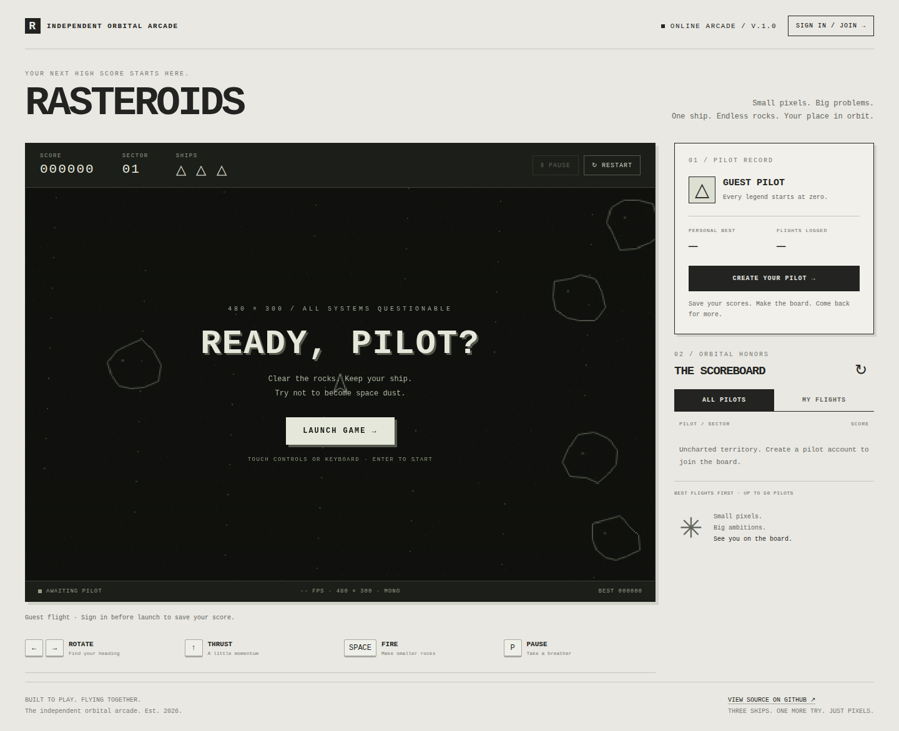

# Rasteroids Web

[](https://github.com/SkyOne771/rasteroids/actions/workflows/ci.yml)
[](https://vps-bbba68b4.vps.ovh.ca)

A browser arcade with persistent pilot accounts, saved scores, a public leaderboard, and multi-touch mobile controls. The Canvas game runs in the browser; a Python standard-library server and SQLite handle accounts and flight records. The live app runs on an OVH VPS with automatic HTTPS, backups, and deployment after passing CI.

**[Play the live demo](https://vps-bbba68b4.vps.ovh.ca)** · **[Architecture](docs/ARCHITECTURE.md)** · **[API and configuration](docs/REFERENCE.md)** · **[Deployment](deploy/README.md)**



This is a portfolio extension of [Akkowicz/rasteroids](https://github.com/Akkowicz/rasteroids), originally a single-file GitHub workshop game. This fork adds the full-stack account/score system, mobile input, deployment, and automated verification. See [project attribution](NOTICE.md).

## Features

- Guest play, pilot registration, case-insensitive usernames, login, and persistent sessions.
- Automatic score submission at game over, personal bests, flight history, and one best flight per pilot on the public board.
- Four multi-touch controls: rotate left/right, thrust, and fire. Play in portrait or landscape; see the [mobile screenshot](docs/images/mobile.png).
- Input cleanup on release, cancellation, lost capture, and focus changes; automatic pause when the page is hidden or the device rotates.
- SQLite persistence, online backups with retention, secure cookies behind HTTPS, and per-client request limits behind the reverse proxy.
- Python HTTP integration tests, JavaScript game regressions, desktop browser flows, and native Chromium multi-touch tests across eight screen sizes.
- Code-generated reference documentation checked in CI, plus automatic deployment of passing `main` commits with version and asset verification.

## Run locally

Requires **Python 3.10+**. The application has no third-party Python dependencies and needs no frontend build.

```sh
git clone https://github.com/SkyOne771/rasteroids.git
cd rasteroids
python3 server.py
```

Open <http://localhost:8000>. Create a pilot account before launching if you want to save scores. Opening `index.html` directly supports offline guest play; accounts and online scores require the Python server.

The default database is `data/rasteroids.sqlite3`, created automatically and excluded from Git. Customize the location or port:

```sh
python3 server.py --port 8001 --database /path/to/scores.sqlite3
```

## Play

On mobile, hold **Left / Right**, **Thrust**, and **Fire**; multiple controls work together. Pause and restart are above the playfield. Rotate the phone for a compact landscape layout. Controls stay captured if a finger slides off a button; the rest of the page remains scrollable.

| Keyboard | Action |
| --- | --- |
| Enter | Start, retry, or resume |
| ← / A, → / D | Rotate |
| ↑ / W | Thrust |
| Space | Fire |
| P | Pause / resume |
| R | Restart |

Large, medium, and small rocks award 20, 50, and 100 points. Clear a sector to advance. You start with three ships and brief invulnerability after respawning. Restart abandons the current flight and resets the score; a completed flight saves at game over. Launch waits for the saved-session check so a signed-in pilot is not accidentally treated as a guest.

## Technical overview

| Layer | Implementation |
| --- | --- |
| Game | JavaScript, Canvas 2D, animation loop, cached starfield, bounded particle lifetime |
| Interface | HTML, CSS, Pointer Events, responsive portrait/landscape layouts |
| Backend | Python standard library, JSON HTTP API, explicit public file allowlist |
| Persistence | SQLite in WAL mode, account-owned flight tokens, idempotent score saves |
| Authentication | Salted scrypt hashes; hashed opaque session tokens; HttpOnly, SameSite cookies |
| Hosting | OVH VPS, systemd, Caddy automatic HTTPS, daily consistent SQLite snapshots |
| Delivery | GitHub Actions checks, locked Playwright tooling, validated releases, health checks and rollback |

<!-- BEGIN GENERATED FACTS -->
**Source-derived interface:** 8 API routes · 4 SQLite tables · 4 touch controls · 5 server options. [Full generated reference](docs/REFERENCE.md).
<!-- END GENERATED FACTS -->

The [reference](docs/REFERENCE.md) is generated from the actual Python and HTML source. CI rejects it when the runtime, tests, deployment code, or workflows change without regeneration. Explanatory prose and screenshots are reviewed alongside behavioral changes; generation cannot validate their meaning automatically.

## Test and maintain documentation

Backend and game regressions require Python and Node.js 22+:

```sh
python3 -m unittest discover -s tests -p 'test_*.py' -v
npm test
```

Install the locked browser tooling, then run the integration suites:

```sh
npm ci
npx playwright install --with-deps chromium
npm run test:browser
npm run test:mobile
```

Browser tests start isolated temporary servers/databases and cover registration, authentication, session reload, delayed-login launches, score history, failed-save recovery, and mobile overflow. The mobile suite tests simultaneous contacts, independent releases, capture loss/cancellation, pause with controls held, orientation, minimum target sizes, normal page scrolling, and points earned by a touch-fired bullet. Some scenarios arrange collisions to test a specific state transition. `NATURAL_GAME=1 npm run test:browser` optionally plays a complete game using only player input.

Touch coverage uses Chromium emulation; physical iPhone/Safari device testing is not claimed. `PLAYWRIGHT_MODULE` and `CHROMIUM_EXECUTABLE_PATH` can select an existing test installation.

After changing code, regenerate and check the reference:

```sh
npm run docs
npm run docs:check
```

See [CONTRIBUTING.md](CONTRIBUTING.md) for the complete development workflow. `npm run screenshots` refreshes the README screenshots using an empty temporary database.

## Deployment and keeping the live site current

Pushes and pull requests run documentation checks, Python tests, game regressions, and both browser suites. A passing push to this repository's `main` branch deploys the exact checked commit to OVH. Pull requests receive no production credentials. Failed checks prevent deployment.

Releases include only allowlisted application files and checksums. A dedicated deployment account can invoke one installed helper; CI cannot replace root-owned system configuration. Deployment backs up the database and previous application files, restarts the service, and restores the previous release if its health check fails. The public [version record](https://vps-bbba68b4.vps.ovh.ca/version.json) identifies the deployed commit and public asset hashes.

See [deploy/README.md](deploy/README.md) for setup, secrets, updates, backup/recovery, and operational commands.

## Scope and limitations

- Scores are computed in the browser. Ownership tokens, validation, and idempotency protect the API, but do not make the leaderboard cheat-proof. Prize-bearing play would need server-authoritative simulation or verified replays.
- Pilot names are public. This edition uses username/password authentication without email verification or self-service password recovery.
- Failed submissions remain queued in the current tab until retried. Closing/reloading that tab or signing out can discard unsaved results.
- Daily app snapshots are stored on the VPS. Keep off-host copies for protection against complete server loss.
- The standard-library HTTP server targets a small initial deployment behind Caddy. Larger traffic requires a production application server and shared persistence.

## Attribution and licensing

Original game: [Akkowicz/rasteroids](https://github.com/Akkowicz/rasteroids) and its contributors. This fork retains that history and documents its added web functionality. The upstream repository did not specify a software license; this fork does not relicense inherited code. See [NOTICE.md](NOTICE.md).
